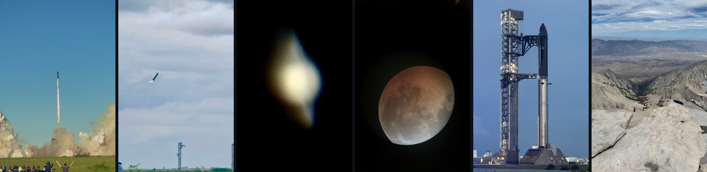

all taken by me: Flight 15 - launch · S42 catch · Saturn from my backyard · a lunar eclipse · Full stack (S42, B22) · Mt. Whitney summit

### ✦ hi, i'm midas ✦

i love to learn new things and help build things nobody's built before

<a href="https://x.com/midasavocado"><picture><source media="(prefers-color-scheme: dark)" srcset="img/x-white.svg"></picture></a>
&nbsp;&nbsp;&nbsp;
<a href="https://github.com/midasavocado"><picture><source media="(prefers-color-scheme: dark)" srcset="img/github-white.svg"></picture></a>

#### ☾ into

space, rockets, planes, math, photography, and OSINT

$$e^{i\pi} + 1 = 0 \qquad T^2 \propto a^3 \qquad z \mapsto z^2 + c$$
