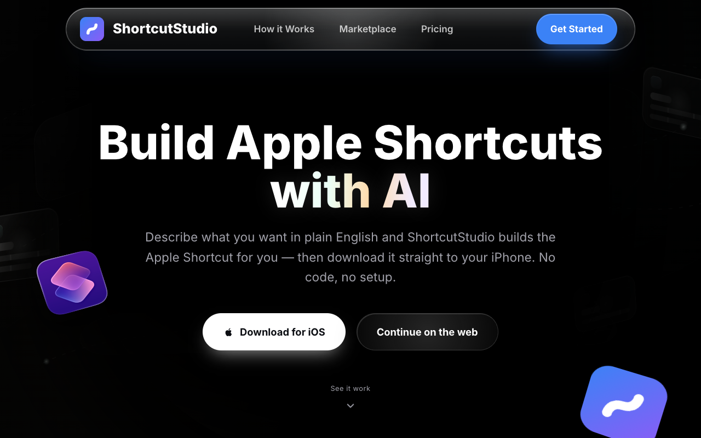
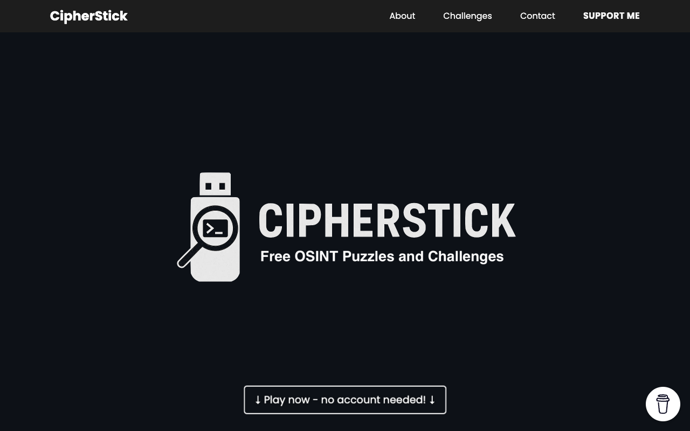
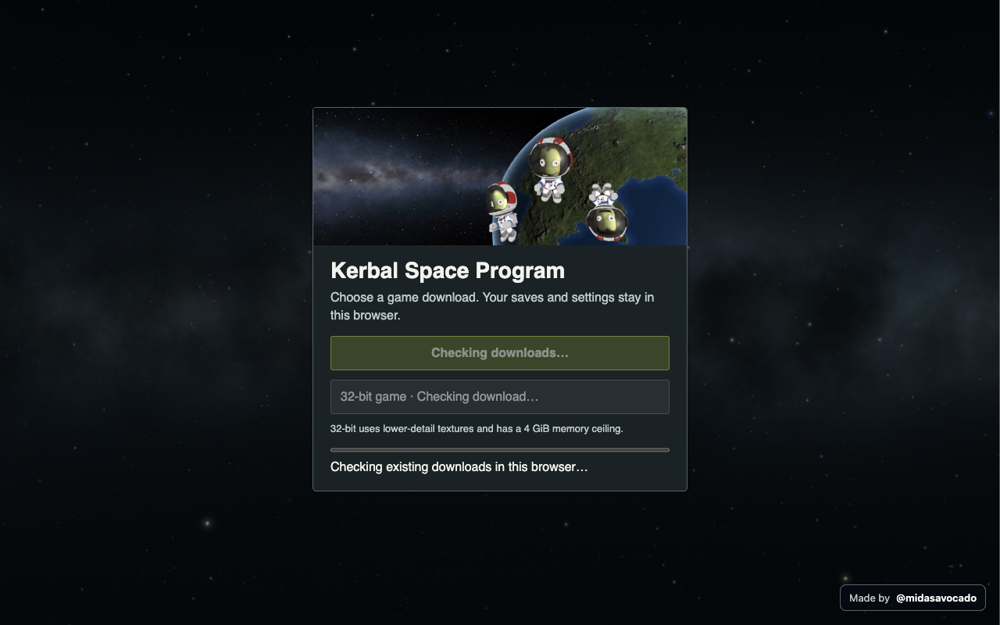
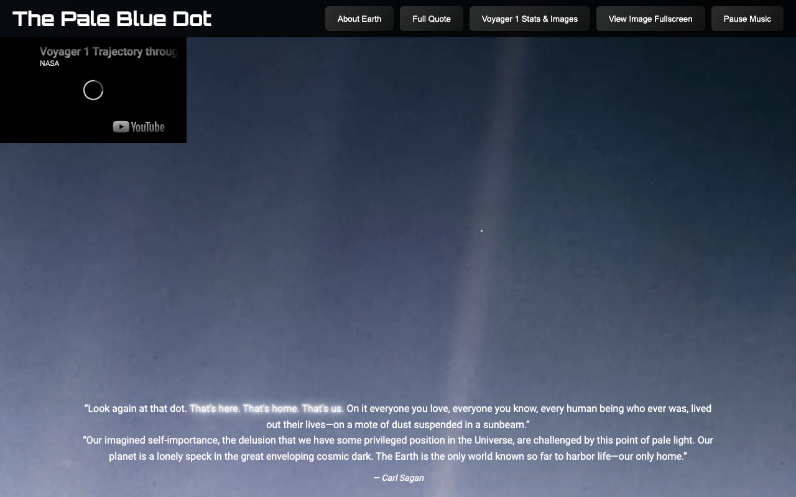

all taken by me: Flight 15 - launch · S42 catch · Saturn from my backyard · a lunar eclipse · Full stack (S42, B22) · Mt. Whitney summit

### ✦ hi, i'm midas ✦

i love to learn new things and help build things nobody's built before

#### ☄ things i've built

<table>
  <tr>
    <td width="50%" valign="top">
      
       <b><a href="https://apps.apple.com/us/app/shortcutstudioapp/id6760745118">ShortcutStudio</a></b> (iOS)
       type what you want in plain English, get a working Apple Shortcut. ~6,500 users.
    </td>
    <td width="50%" valign="top">
      
       <b><a href="https://cipherstick.tech">CipherStick</a></b>
       free OSINT puzzles in the browser.
    </td>
  </tr>
  <tr>
    <td width="50%" valign="top">
      
       <b><a href="https://kerbalspaceprogram.pages.dev">KSP on the web</a></b>
       I got Kerbal Space Program to run in a browser tab.
    </td>
    <td width="50%" valign="top">
      
       <b><a href="https://ourpalebluedot.netlify.app">The Pale Blue Dot</a></b>
       a small site about Voyager's photo of Earth.
    </td>
  </tr>
</table>

#### ☾ into

space, rockets, and math that turns into pictures.

$$e^{i\pi} + 1 = 0 \qquad T^2 \propto a^3 \qquad z \mapsto z^2 + c$$

#### ✶ find me

[midaswilliam.com](https://midaswilliam.com) · [𝕏 @midasavocado](https://x.com/midasavocado)
